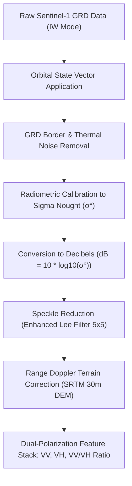

# JALASHAYA — Scientific Research Methodology

**Research Reference:**  
*Mapping changes in Water Bodies of Bengaluru with Sentinel-1*  
**Author:** Preethi Balaji, PhD (April 11, 2022)  
**Publication Source:** [ArcGIS StoryMaps](https://storymaps.arcgis.com/stories/1e6a0e96459d4601914890da5cd2b0cc)  
**Extended Research:** *Analysis of Environmental and Atmospheric Influences in the Use of SAR and Optical Imagery from Sentinel-1, Landsat-8, and Sentinel-2 in the Operational Monitoring of Reservoir Water Level* (MDPI Remote Sensing, 2022).

---

## 1. Scientific Objective
To monitor, extract, and quantify multi-temporal surface water dynamics across Bengaluru and Karnataka lake basins using all-weather, day-and-night Synthetic Aperture Radar (SAR) from the Copernicus Sentinel-1 constellation, mitigating the severe cloud cover limitations of optical sensors during the Indian Southwest and Northeast monsoons.

---

## 2. Satellite Data Acquisition: Sentinel-1 C-Band SAR

| Parameter | Research Specification | Operational Implementation |
|---|---|---|
| **Constellation** | Sentinel-1A / Sentinel-1B | Copernicus Sentinel-1 C-band SAR |
| **Product Level** | Ground Range Detected (GRD) | Level-1 GRD High Resolution (HR) |
| **Acquisition Mode** | Interferometric Wide Swath (IW) | IW Mode (250 km swath) |
| **Pixel Spacing** | 10 m × 10 m | 10 m spatial resolution |
| **Polarizations** | Dual Polarization: VV + VH | Co-polarization (VV) + Cross-polarization (VH) |
| **Temporal Window** | May Annual Baselines (2016–2021) | May 2016–2021 reproduction + 2022–2026 extended |
| **Orbit Configuration** | Descending / Ascending Pass Tracking | Ascending (Relative Orbit 47) / Descending (Track 12) |

### Why May Acquisitions?
In Karnataka, May represents the pre-monsoon dry season minimum. Analyzing May composites across consecutive years controls for seasonal cyclical inundation, isolating permanent urban encroachment and anthropogenic desiccation from regular seasonal monsoonal recharge.

---

## 3. SAR Preprocessing Workflow

1. **Radiometric Calibration:**
   $$\sigma^0 = \frac{DN^2}{A_i^2}$$
   Converted to logarithmic decibel scale:
   $$\sigma^0_{\text{dB}} = 10 \cdot \log_{10}(\sigma^0)$$
2. **Backscatter Physical Characteristics:**
   - **Calm Surface Water:** Acts as a specular reflector. Most radar pulses bounce away from the sensor, yielding very low backscatter ($\sigma^0_{\text{VV}} < -17\text{ dB}$, $\sigma^0_{\text{VH}} < -24\text{ dB}$).
   - **Urban Settlements & Buildings:** Act as dihedral / corner reflectors with double-bounce effects, yielding very high backscatter ($\sigma^0_{\text{VV}} > -8\text{ dB}$).
   - **Vegetation / Agricultural Soils:** Diffuse volume scattering with intermediate values.
3. **Polarization Ratio:**
   $$\text{Ratio}_{\text{VV/VH}} = \sigma^0_{\text{VV}} - \sigma^0_{\text{VH}}\quad(\text{in dB})$$

---

## 4. Machine Learning Classification: 3-Class Random Forest

### 4.1 Target Classes
- **Class 1 — WATER:** Open surface water, lake basins, wet sediment, reservoirs.
- **Class 2 — SETTLEMENT:** High-density urban built-up, concrete structures, commercial buildings, paved roads.
- **Class 3 — OTHER:** Wetland vegetation, floating hyacinth, agricultural fallow, grasslands, open soil mounds.

### 4.2 Training & Feature Stack
- **Input Features ($X$):**
  1. $\sigma^0_{\text{VV}}$ (Decibels)
  2. $\sigma^0_{\text{VH}}$ (Decibels)
  3. $\text{Ratio}_{\text{VV/VH}}$ (Decibels)
  4. Radar Difference Index: $(\sigma^0_{\text{VV}} - \sigma^0_{\text{VH}}) / (\sigma^0_{\text{VV}} + \sigma^0_{\text{VH}})$
- **Algorithm:** Scikit-Learn `RandomForestClassifier` with $N=100$ estimators, Gini impurity criterion, and balanced class weights.
- **Sampling Scheme:** Spatially separated polygon clusters across reference water bodies (Bellandur, Varthur, Hebbal, Yelahanka) and surrounding urban zones to prevent spatial autocorrelation leakage.

### 4.3 Rigorous Statistical Validation
Accuracy is computed independently on held-out test splits ($30\%$) and spatially disjoint cross-validation folds:
- **Overall Accuracy:** $\frac{TP + TN}{\text{Total}}$
- **Class-Specific Precision & Recall**
- **$F_1$-Score:** $2 \cdot \frac{\text{Precision} \cdot \text{Recall}}{\text{Precision} + \text{Recall}}$
- **Cohen's Kappa ($\kappa$):**
  $$\kappa = \frac{p_o - p_e}{1 - p_e}$$
- **Intersection over Union (IoU / Jaccard Index):** $\frac{|A \cap B|}{|A \cup B|}$

---

## 5. Potential Encroachment vs Seasonal Variation Analysis

> [!IMPORTANT]
> **Scientific Constraint:** A reduction in surface water area is **NOT** automatic evidence of illegal encroachment.

The JALASHAYA engine classifies every observed change into 5 distinct legal and scientific categories:
1. **Water Extent Reduction:** True reduction in water extent without confirmed permanent structural built-up.
2. **Potential Built-up Encroachment:** Specific pixels within the legal cadastral boundary where historical Water has been replaced by **Class 2: Settlement** (concrete, buildings, roads).
3. **Seasonal Water Variation:** Normal dry-season cyclic contraction correlated with low rainfall prior to acquisition.
4. **Siltation / Aquatic Weed Infestation:** Basin area converted to **Class 3: Other** due to hyacinth or dredging mounds.
5. **Uncertain Change / Ground Verification Required:** Spectral ambiguities near boundary margins requiring field physical survey.
